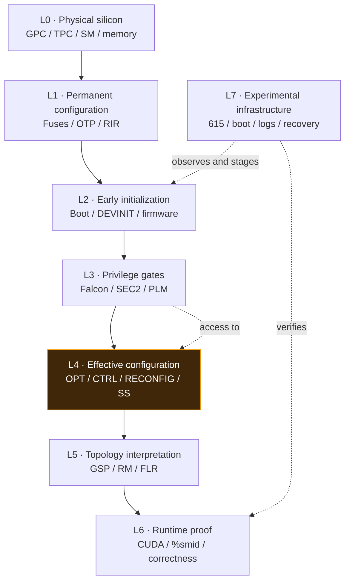

# Ampere Annihilation

**A living evidence-led atlas for NVIDIA GPU architecture, configuration, and reverse engineering.**

This repository separates what hardware **reported**, what a register **accepted**, what firmware **recognized**, and what silicon **actually executed**. It starts with the GA102 RTX 3080 and GA104 RTX 3070 Mobile on the Blitzcore research rig, with CMP 170HX/GA100 as a comparative case.

> **Snapshot: 2026-10-21.** Blitzcore is reported healthy on NVIDIA 615.71.09, with GA102 **68 SMs** and GA104 **40 SMs**, both running SS0 `0x88888888` / SS1 `0x8`. No extra GA102 SM has been demonstrated. Device readings here originate from research-session reports; raw logs should be attached and cross-linked as they become available.

## Explore the atlas

| Section | Purpose |
| --- | --- |
| [Eight-layer architecture](architecture/LAYERS.md) | Where physical devices, fuses, initialization, privilege, registers, topology, execution, and tooling fit together |
| [Blitzcore / GA102 case study](devices/GA102-BLITZCORE.md) | Hardware baseline, cold-trial sequence, observation-versus-inference |
| [Register and permission map](registers/REGISTER-MAP.md) | Addresses, access windows, measured changes, unresolved identities |
| [Evidence ledger](evidence/LEDGER.md) | Stable claim IDs, confidence/provenance and competing explanations |
| [Research questions](research/OPEN-QUESTIONS.md) | Gaps, falsifiers, and candidate next measurements |

## Eight conceptual layers

**This is a classification, not an authoritative boot ordering.** Boot stage, register ownership, and sampling/latching time are separate axes. The atlas will revise edges when measurements justify them.

## Current GA102 mystery

During a controlled early-entry trial, GPC0/TPC0 RECONFIG override changed **0 → 1**, while its effective STATUS stayed **1 → 1**. Candidate OPT0 stayed **1**, and CTRL0 stayed **0**. This favors an independent disable source *if* the published GA100 composition rule applies to GA102 and STATUS is evaluated live; neither condition is established. The trial did not complete a second Booter pass, FLR, or driver topology enumeration.

**Do not confuse a register write/readback with recovered execution hardware.** Acceptance requires physical/effective STATUS changes, reported topology, distinct `%smid` execution, and arithmetic correctness.

## Evidence discipline

- **Reported observation:** directly stated from a specified research run; preserve original values and pending log references.
- **Externally documented:** appears in a linked upstream project, but may apply to a different chip.
- **Inference / hypothesis:** mechanism that explains observations; state competing interpretations.
- **Unknown:** missing register identity, permission, access timing, or firmware behavior.

Never promote a GA100-specific register formula to a GA102 fact without testing. Keep irreversible OTP changes distinct from volatile overrides. Link raw captures to claims when available, and keep old findings even when their interpretation changes.

## Primary external reference points

- [Morrowmake CMP 170HX RECONFIG override commit](https://github.com/Morrowmake/cmpunlocker/commit/19254b5ce80f801af7c7516211846b889cac359c) — published GA100/170HX 70→74 SM result and candidate STATUS formula.
- [NVIDIA open-gpu-kernel-modules](https://github.com/NVIDIA/open-gpu-kernel-modules) — public driver source, **not** a comprehensive GA102 fuse manual.
- [NVIDIA open-gpu-doc](https://github.com/NVIDIA/open-gpu-doc) — public hardware documentation.
- [CMP 170HX fuse survey](https://github.com/Consensus-Protocol/cmp170hx/blob/main/docs/hardware/fuses-and-otp.md) — third-party cross-card register observations.

## Contributing discoveries

Record the board/die, driver/firmware identity, exact stage, register before/after, observed effects, logs or commit link, and whether the outcome was confirmed by execution. Assign a stable `AA-###` evidence ID in the ledger, then cross-link the relevant layer and device page.

*Research atlas only; it does not deploy patches or authorize experiments on any machine.*