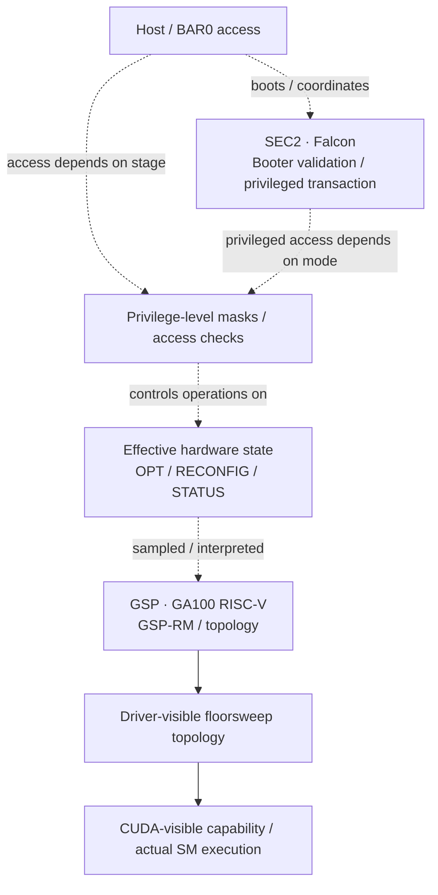

# GA100 engine and firmware-processor atlas

**Source status:** The inventory below was supplied in the research conversation on **2026-10-21**. It is a starting set of engine landmarks, **not** a validated inventory of distinct Falcon CPU cores or GA102-compatible addresses. A subset has independent source corroboration linked below.

This map spans **L0** (physical compute engines), **L2** (boot/firmware roles), and **L3** (privileged request paths and security gates). Do not conflate the existence of a BAR0 register aperture with proof of an active CPU, a readable instruction image, or host write authority.

## GA100 candidates and source qualification

| Engine / feature | Supplied BAR0 base(s) | Supplied PRI request ID | Supplied SCP? | Core type / qualification |
| --- | --- | --- | --- | --- |
| SEC2 (Security Engine 2) | `0x840000` | 2 | Yes | **Falcon, confirmed** by GA100 driver and SEC2 register definitions; runs SEC2 Booter microcode |
| GSP (GPU System Processor) | `0x110000` | 3 | Yes | **RISC-V on GA100, not a Falcon CPU**; public CMP 170HX analysis identifies GSP-RM NVRISCV at `0x110000 / 0x111000`; supplied SCP claim should not be assumed to describe its RISC-V core |
| PMU (power management) | `0x10a000` | 1 | No | Falcon-family management engine; full GA100 engine access and individual security features not independently verified here |
| FBFALCON (framebuffer / memory) | `0x9a4000` | — | No | Falcon-family controller **claimed in inventory**; independently establish exact GA100 aperture and role |
| FECS (front-end context switch) | `0x409000` | 4 | No | Front-end context-switch firmware processor; inventory's exact GA100 mapping and request ID need source-level corroboration |
| NVLink MINION | `0xa06000 / 0xa46000 / 0xa86000` | — | No | NVLink management engines **listed by source**; core architecture and accessible instances not verified here |
| NVDEC | `0x848000 + n × 0x4000` | — | Unknown | Video-decode engine / possible control processor; instance bases in the pasted inventory not independently verified; exposed instances are SKU-dependent |
| IFR | — | 6 | — | **Not established as a distinct Falcon CPU.** IFR means *Init-from-ROM*, documented as a ROM/VBIOS initialization feature; no Falcon base supplied |

**Important corrections / caveats:**

- **GSP on GA100 is RISC-V**, unlike the SEC2 Falcon. NVIDIA's Falcon-style register windows and naming around GSP do not prove its running core is Falcon.
- **IFR is not confirmed as a separate physical CPU**. Documenting IFR's ROM role is useful, but it should not be counted among independently confirmed Falcon cores.
- The assertion **"every entry has its own IMEM/DMEM and 4 KiB BAR0 page"** is not validated by this table. SEC2 has well-documented Falcon apertures; apply analogous claims to other entries only after register/firmware evidence.
- The supplied PRI request IDs and per-engine SCP indicators remain **unverified claims** unless accompanied by an appropriate named source or raw capture. Security capabilities can differ between a processor, its Falcon interface, and a crypto service elsewhere in the boot chain.
- The provided addresses describe **GA100 candidate mappings**, not automatic substitutes for GA102 addresses.

## Control-plane sketch

**Diagram intent:** logical responsibility, *not* the order of exact hardware initialization or a claim that all authorization passes through one PLM.

## Why this helps our GA102 investigation

Blitzcore's GPC0/TPC0 override accepted a register write but STATUS stayed asserted. A register might be seen differently by **host BAR0**, **SEC2 after Booter**, or **GSP/RM when topology is gathered**. The engine atlas makes those distinct measurement contexts explicit. The next evidence should name the engine, firmware/privilege state, sampling stage, and device generation, rather than just an address.

The current case study remains [GA102 on Blitzcore](../devices/GA102-BLITZCORE.md); this page is **GA100-centric comparative background**.

## External corroboration and verification queue

- [GA100 SEC2 driver, NVIDIA 615.71.09](https://fossies.org/dox/NVIDIA-open-gpu-kernel-modules-615.71.09/kernel__sec2__ga100_8c_source.html) confirms the SEC2 Falcon configuration.
- [GA100 SEC2 published header](https://fossies.org/dox/NVIDIA-open-gpu-kernel-modules-615.71.09/ampere_2ga100_2dev__sec__pri_8h_source.html) describes the SEC2 BAR0 region at `0x840000`.
- [CMP 170HX SEC2 Booter analysis](https://github.com/Consensus-Protocol/cmp170hx/blob/main/docs/unlock/falcon-and-booter.md) distinguishes SEC2 Falcon and GSP RISC-V.
- [Linux nova IFR documentation](https://docs.kernel.org/next/gpu/nova/core/vbios.html) describes IFR as Init-from-ROM hardware/VBIOS metadata.
- [Public GA100 hardware reference index](https://nvidia.github.io/open-gpu-doc/manuals/ampere/ga100/) for additional register identification.

**To validate the remaining rows:** find device-specific symbols for each BAR0 base, confirm actual running engine/core type, prove the PRI request ID mapping, and separately verify SCP capability. Track any board-specific read as an evidence-ledger entry with its source.
