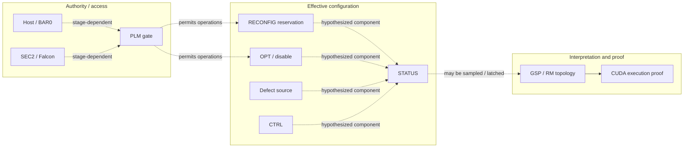

# Eight-layer architecture map

The layers group **different kinds of evidence**. They do not imply a simple chronological sequence or guarantee that all GPUs implement the same circuitry. For every register, ask four separate questions: **where** is it, **when** is it accessible, **who** owns its permission, and **when** is its value consumed?

| Layer | What belongs here | Present evidence or question |
| --- | --- | --- |
| **L0 — Physical silicon** | Actual GPC/TPC/SM presence, defect status, memory controllers and wiring | GA102 has resources excluded from its 68-SM active topology; operational condition of excluded units unknown |
| **L1 — Permanent configuration** | OTP/fuses, RIR remapping, manufacturing bins, fuse shadow/override permission | Distinguish factory disable, defective units, and software-override enablement; do not conflate GA100 and GA102 |
| **L2 — Early initialization** | Boot ROM, DEVINIT, GFW, FWSEC, SEC2 boot stages | Known privileged path occurs after GFW/FWSEC; an equivalent earlier path has not been shown |
| **L3 — Privilege gates** | Register PLMs and host/Falcon/SEC2 access control | RECONFIG PLM opened during cold trial; second Booter pass timed out attempting FEAT PLM |
| **L4 — Effective configuration** | OPT, DISABLE, DEFECTIVE, CTRL, RECONFIG, OVERRIDE, STATUS, tensor selectors | GPC0 override accepted but STATUS stayed asserted; suspected OPT source unresolved |
| **L5 — Topology interpretation** | GSP/RM masks and discovery; reset boundaries and latches | Earlier selector overrides preceded GSP discovery; latest SM trial did not reach topology measurement |
| **L6 — Runtime execution** | CUDA properties, distinct `%smid`, arithmetic/correctness, throughput, Xids | 68 GA102 / 40 GA104; SS selector throughput improvement demonstrated; GA102 SM increase not demonstrated |
| **L7 — Experiment infrastructure** | 615 driver, cold-entry staging, logs, watchdog/containment, recovery, regression tests | Working automatic selector unlock and recovered HiveOS boot; instrumentation/recovery must not be mistaken for GPU behavior |

## Multiple axes, not one ladder

**Dashed edges are hypotheses or conditional relationships**; the composition of GA102 STATUS and its sampling time remain unproven.

## Boot-time map (coarse and provisional)

| Event / boundary | Currently known | Missing |
| --- | --- | --- |
| Prior to GFW / FWSEC | No demonstrated equivalent privilege override point | Accessible registers and topology/fuse sampling |
| First privileged SEC2/Booter transaction | Successful RECONFIG PLM access and GPC0 OVERRIDE write/readback | Whether STATUS is live or previously latched |
| SEC2 reset | GPC0 STATUS continued reading 1 | Whether any internal masks were recomputed |
| Second Booter pass, experimental path | FEAT PLM opening timed out; CPUCTL entry differed from first pass (`0x0` vs `0x10`) | Root cause of altered SEC2 state |
| FLR and subsequent GSP/RM init | **Not reached in failed cold SM trial** | Whether hypothetical changed config would propagate to topology |
| Known-good production 615 boot | RTX 3080 68 SM, RTX 3070 Mobile 40 SM, selectors unlocked | Whether any disabled GA102 SM can execute |

References: [GA102 case study](../devices/GA102-BLITZCORE.md), [register map](../registers/REGISTER-MAP.md), [ledger](../evidence/LEDGER.md).